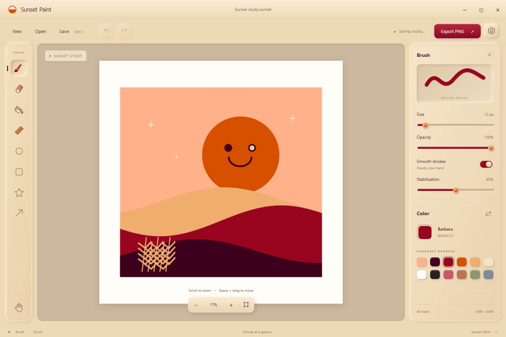

# Sunset Paint

A Windows drawing app with smooth brushes, a warm palette, tactile controls, and very deep zoom. MIT licensed.



[Download the Windows installer](https://github.com/proczdev/SunsetPaint/releases/latest/download/Sunset-Paint-Setup.exe) · [Build from source](#build-from-source) · [Contribute](CONTRIBUTING.md) · [Develop with AI](docs/AI-PROMPT.md)

The download link becomes available when the first GitHub Release is published with the asset named `Sunset-Paint-Setup.exe`. See [publishing](docs/PUBLISHING.md).

## What it does

- Brush and eraser with adjustable size; brush opacity and optional stabilization.
- Ruler lines, ellipses, rectangles, stars, arrows, and filled shapes.
- Flood fill with adjustable tolerance and a small edge overlap to reduce white seams.
- Cursor-centered zoom, panning, and a brush that keeps its on-screen diameter as you zoom.
- Paste clipboard images with **Ctrl V**. Undo and redo include pasted images.
- Editable `.sunset` project files, local recovery, and full-canvas PNG export.
- Adjustable undo history, paper color, reduced motion, and synthesized click sounds with mute and volume.
- Runs locally without an account or network connection.

## Install

Download `Sunset-Paint-Setup.exe` from [Releases](https://github.com/proczdev/SunsetPaint/releases). Run it to install for the current Windows user. It adds Start menu and desktop shortcuts. Uninstall through Windows Settings → Apps.

Windows 10 / 11, x64. The installer is currently unsigned. No administrator installation is required.

## Build from source

The project was built with **Node.js 24**, npm 11, Electron 40, and electron-builder 26 on Windows x64. Use Node.js 24 for a reproducible starting point. Dependencies are pinned in `package-lock.json`.

```powershell
git clone https://github.com/proczdev/SunsetPaint.git
cd SunsetPaint
npm ci
npm start
```

Package a Windows installer:

```powershell
npm run build
```

Output: `release/Sunset-Paint-Setup.exe`. For an unpacked application directory, run `npm run build:portable`; output: `release/win-unpacked/`. The build downloads Electron and packaging tools on its first run. Building on Windows is the supported route.

`signExecutable: false` is intentional for the unsigned community build. If you add signing, configure credentials outside the repository and never commit certificates or secrets.

## Controls

| Action | Shortcut |
| --- | --- |
| Brush / Eraser / Fill / Ruler | B / E / F / R |
| Ellipse / Rectangle / Star / Arrow | O / U / S / A |
| Move canvas | H, or hold Space and drag |
| Zoom | Mouse wheel over the canvas |
| Fit canvas | 0 |
| Brush size | [ / ] |
| Swap current and previous colors | X |
| Paste clipboard image | Ctrl V |
| Undo / Redo | Ctrl Z / Ctrl Shift Z |
| Save project | Ctrl S |

Hold Shift while making a shape for equal proportions; ruler lines and arrows snap to 45° angles.

Open [the example project](examples/Sunset-study.sunset) in Sunset Paint. Zoom into the sun's right eye to find the smaller face.

## Saving and practical limits

- The outer canvas is **4096 × 4096**. Zoom reaches up to **10¹²×**, subject to floating-point precision; it is not mathematically infinite.
- A brush size is measured in screen pixels when a stroke starts. Stored mark widths and points use world coordinates.
- `.sunset` stores vector marks and embedded pasted images. PNG exports a flattened **4096 × 4096** image, so microscopic detail is preserved in projects rather than at every PNG pixel scale.
- Fill samples the visible viewport and stores a vector contour. Keep the enclosed boundary visible when filling it. A fill may slightly overlap the inside edge of a stroke.
- Erasing paints with the current paper color; it does not currently remove geometry or create transparency.
- Pasted images are placed at the view center. Selection, moving/resizing pasted images, layers, pressure sensitivity, and SVG export are not implemented yet.
- Undo history is session-only, configurable from 5 to 2000 steps. Project files do not contain undo snapshots.
- Recovery stores one current canvas in Electron's per-user data directory (`app.getPath('userData')`). Save separate project files to keep multiple drawings. Recovery and project content are never uploaded by the app.

## Repository map

```text
main.js                 Electron window, dialogs, file I/O, recovery
preload.js              Narrow context-isolated IPC bridge
app.js                  Tools, scene, rendering, zoom, history, paste, sound
index.html              Desktop controls and dialogs
style.css               Desktop palette, tactile materials, animations
icon.ico / icon.png     App icons
website/                Static website; no framework or build step
  config.js             Repository, branch, version, installer filename
  sound.js              Same click synthesis as the desktop app
  assets/               Real app screenshots and the example project
examples/               Editable example drawing
docs/                   Architecture, AI prompt, publishing guide
scripts/                Electron smoke checks, screenshot capture, web server
.github/workflows/      Windows build and optional GitHub Pages deployment
```

## Add a feature

Start with [CONTRIBUTING.md](CONTRIBUTING.md) and [the architecture map](docs/ARCHITECTURE.md). For AI-assisted changes, paste [the development prompt](docs/AI-PROMPT.md) into your coding assistant, replace its task section, and have it read `AGENTS.md` before editing.

Keep changes small and explain the behavior, code touched, focused validation, and any limits. A new mark tool must render at multiple zoom levels, undo/redo, save/open, recover, and export correctly.

## Focused checks

```powershell
npm test
npm run test:sound
npm run screenshots
```

Checks run in a separate Electron profile without opening user recovery. They cover brush input, ellipse/fill, eraser, anchored zoom, clipboard image handling, keyboard undo/redo, project roundtrip, PNG export, settings, and sound controls. Generated check outputs go in `.artifacts/`; screenshot capture intentionally updates `website/assets/` and the example project.

These are smoke checks, not exhaustive testing. Manually check a changed tool at normal and deep zoom and verify the installed package when changing packaging or IPC.

## Website

```powershell
npm run website
```

Open the printed `http://127.0.0.1:4173` address. This script uses only Node's built-in modules; the site itself is plain HTML, CSS, and JavaScript. It includes a separate browser scratchpad, real app screenshots, the same synthesized click sounds, and persistent mute/volume preferences.

Edit `website/config.js` to change repository or release links. You can host the `website/` directory on any static host, or run the included GitHub Pages workflow after enabling Pages. See [publishing](docs/PUBLISHING.md).

## License

[MIT](LICENSE), copyright © 2026 Procz8Fox. This license covers the original app, website, documentation, icons, and example artwork in this repository. Electron and other dependencies retain their own licenses; packaged Electron license notices must remain intact.
